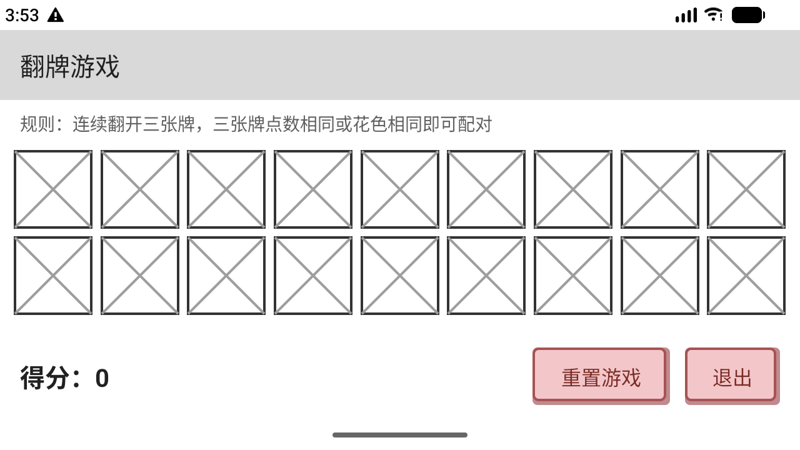

# 翻牌游戏（Android）

一个包含「个人信息」与「RecyclerView 翻牌游戏」的 Android 课程作业项目，使用 Kotlin + XML 布局实现，采用 MVC 结构。

> 姓名：王浩宇　学号：2024110536

## 作业五要求实现情况

- **RecyclerView 游戏界面**：24 张牌使用 `RecyclerView` + `GridLayoutManager` 展示，竖屏 4 列 6 行。
- **适配器**：`CardAdapter` 继承自 `RecyclerView.Adapter`，实现 `onCreateViewHolder`、`onBindViewHolder`、`getItemCount`，并通过回调把点击事件交给 Activity 处理。
- **模型**：`CardMatchingGame` 新增 `reset()`，`chooseCardAtIndex` 与 `Card.match` 改造成三张牌游戏逻辑。
- **控制器**：`CardGameActivity` 负责组织模型与适配器，支持横竖屏不同牌数（竖屏 24 张、横屏 18 张）。
- **菜单与对话框**：`MainActivity` 的 Toolbar 菜单包含「关于」，点击后弹出关于对话框。
- **字符串资源**：所有界面文案均定义在 `res/values/strings.xml`，布局与代码中不直接出现界面字符串。
- **主题**：使用 `Theme.MaterialComponents.Light.NoActionBar.Bridge`，保证自定义按钮背景在最新 Material 环境下正常显示。

## 功能

- **个人信息主页**：显示头像、姓名、性别、学号、电话、邮件地址、爱好以及游戏最高分；Toolbar 显示「王浩宇 + 2024110536」。
- **信息修改**：可修改头像（从相册选择）、姓名、学号、电话号码、电子邮件地址，选择性别与爱好，保存后返回主页。
- **三张牌配对游戏**：
  - 连续翻开三张牌，三张牌**点数全部相同**或**花色全部相同**即可配对。
  - 三张同点数：`8 × 4 = 32` 分；三张同花色：`4 × 4 = 16` 分。
  - 每翻开一张牌扣 1 分，配对失败扣 2 分。
  - 支持「重置游戏」和「退出」，最高分会持久化到本地。
- **横竖屏适配**：牌数与列数由 `values/integers.xml` 和 `values-land/integers.xml` 配置，旋转屏幕后自动切换牌数并重新布局。
- **数据持久化**：个人资料、头像与游戏最高分均保存在本地，重启应用后仍然有效。

## 截图

| 个人信息主页 | 信息修改 | 翻牌游戏（竖屏） | 翻牌游戏（横屏） |
| --- | --- | --- | --- |
|  |  |  |  |

## MVC 结构与项目文件

```
app/src/main/java/
├── cn/edu/sicnu/cardgame/               # Model（纯 Kotlin，可在 JVM 上测试）
│   ├── Card.kt                          # 单张扑克牌、三张牌匹配规则
│   ├── Deck.kt                          # 52 张牌堆
│   └── CardMatchingGame.kt              # 游戏状态、reset 与三张牌计分
└── cn/edu/sicnu/cs/why/myapplication/
    ├── MainActivity.kt                  # Controller：主页、菜单与关于对话框
    ├── PersonInfoActivity.kt            # Controller：信息修改页
    ├── CardGameActivity.kt              # Controller：游戏页，横竖屏牌数适配
    ├── CardAdapter.kt                   # View：RecyclerView 适配器与点击回调
    ├── ProfileStore.kt                  # 个人资料 / 最高分存储（SharedPreferences）
    ├── AvatarStore.kt                   # 头像读取与保存
    └── CrossBoxView.kt                  # 头像占位框 / 卡背叉号绘制
```

关键资源：

- `res/layout/activity_card_game.xml`：RecyclerView 游戏界面
- `res/layout/item_card.xml`：单张牌布局
- `res/menu/menu_main.xml`：主页菜单
- `res/values/integers.xml` / `res/values-land/integers.xml`：竖屏 / 横屏牌数与列数

## 测试

**单元测试**（`app/src/test`，纯 JVM，无需设备）：

- `CardTest`：牌面显示、红花色判断、三张同点数 / 同花色匹配、非匹配组合
- `DeckTest`：52 张牌唯一性、花色与点数数量
- `CardMatchingGameTest`：选牌扣分、取消选择、三张牌配对加分、失配扣分、已配对牌不可再选、`reset()` 重置

**UI 测试**（`app/src/androidTest`，Espresso）：

- 主页信息、Toolbar 与按钮显示
- 打开溢出菜单并点击「关于」后显示关于对话框
- 点击「修改个人信息」进入信息修改页
- 保存后主页信息同步更新
- 游戏页包含配置的牌数（竖屏 24 张）且初始得分为 0
- 翻牌扣分、重置后得分归零
- 退出游戏返回主页

```bash
# 单元测试
./gradlew testDebugUnitTest

# UI 测试（需要已连接设备或运行中的模拟器）
./gradlew connectedDebugAndroidTest
```

## 构建与运行

环境：Android Studio、JDK 17+，compileSdk 37，minSdk 24。

```bash
./gradlew assembleDebug
```

生成的 APK 位于 `app/build/outputs/apk/debug/app-debug.apk`，也可直接用 Android Studio 运行。

## Git 分支

- `main`：稳定版本，已设置为禁止直接 push，通过 Pull Request 审核合并。
- `Dev`：作业五开发分支，包含 RecyclerView、菜单与三张牌游戏的全部改动。
