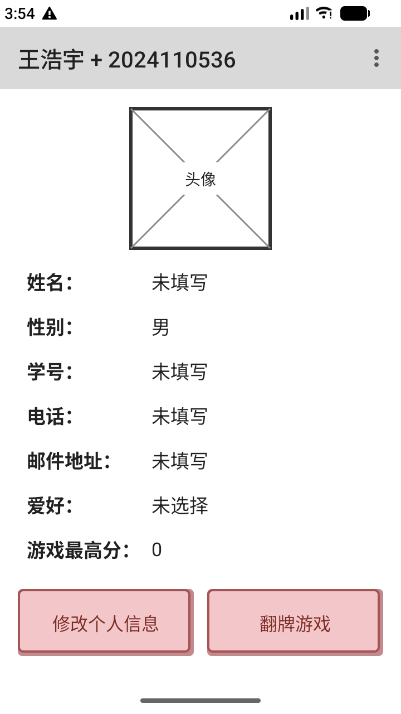
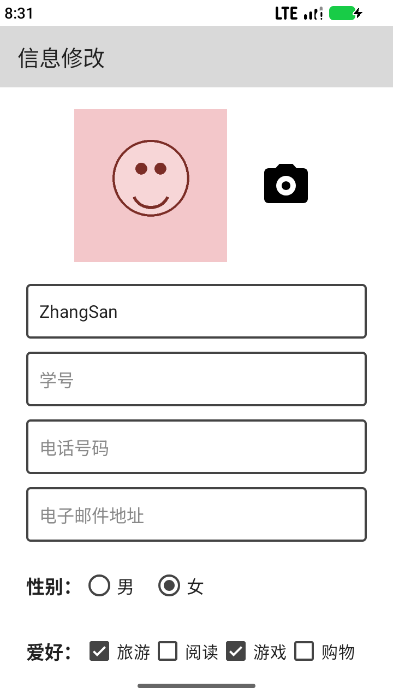
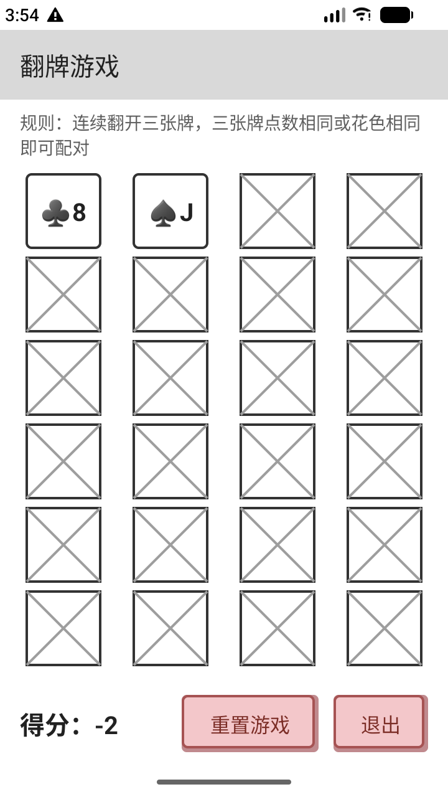

# 翻牌游戏（Android）

一个包含「个人信息」与「翻牌游戏」的 Android 课程作业项目，使用 Kotlin + XML 布局实现。

> 姓名：王浩宇　学号：2024110536

## 功能

- **个人信息主页**：显示头像、姓名、性别、学号、电话、邮件地址、爱好以及游戏最高分。
- **信息修改**：可修改头像（从相册选择）、姓名、学号、电话号码、电子邮件地址，选择性别与爱好，保存后返回主页。
- **翻牌游戏**：4×4 共 16 张扑克牌，点击翻牌；同点数或同花色的两张牌配对成功，实时显示得分。
  - 配对成功：点数相同得 16 分，花色相同得 4 分
  - 每次选牌扣 1 分，配对失败扣 2 分
  - 支持「重置游戏」和「退出」
- **数据持久化**：个人资料、头像与游戏最高分均保存在本地，重启应用后仍然有效。
- **字符串资源**：所有界面文案均定义在 `res/values/strings.xml`，布局与代码中不直接出现字符串。
- **主题**：使用 `Theme.MaterialComponents.Light.NoActionBar.Bridge`，保证自定义按钮背景在最新 Material 环境下正常显示。

## 截图

| 个人信息主页 | 信息修改 | 翻牌游戏 |
| --- | --- | --- |
|  |  |  |

> 截图为开发阶段示意，实际应用标题为「王浩宇 + 2024110536」。

## 项目结构

```
app/src/main/java/
├── cn/edu/sicnu/cardgame/          # 游戏模型
│   ├── Card.kt                     # 单张扑克牌及匹配规则
│   ├── Deck.kt                     # 52 张牌堆
│   └── CardMatchingGame.kt         # 游戏状态与计分逻辑
└── cn/edu/sicnu/cs/why/myapplication/
    ├── MainActivity.kt             # 个人信息主页
    ├── PersonInfoActivity.kt       # 信息修改页
    ├── CardGameActivity.kt         # 翻牌游戏页
    ├── ProfileStore.kt             # 个人资料 / 最高分存储（SharedPreferences）
    ├── AvatarStore.kt              # 头像读取与保存
    └── CrossBoxView.kt             # 头像占位框 / 卡背叉号绘制
```

## 测试

**单元测试**（`app/src/test`，纯 JVM，无需设备）：

- `CardTest`：牌面显示、点数/花色匹配规则
- `DeckTest`：52 张牌唯一性、花色与点数数量
- `CardMatchingGameTest`：选牌扣分、取消选择、配对加分、失配扣分、已配对牌不可再选

**UI 测试**（`app/src/androidTest`，Espresso）：

- 主页信息与按钮显示
- 点击「修改个人信息」进入信息修改页
- 保存后主页信息同步更新
- 游戏页包含 16 张牌且初始得分为 0
- 翻牌扣分、重置后得分归零
- 退出游戏返回主页

```bash
# 单元测试
./gradlew testDebugUnitTest

# UI 测试（需要已连接设备或运行中的模拟器）
./gradlew connectedDebugAndroidTest
```

## 构建与运行

环境：Android Studio、JDK 17+，compileSdk 37，minSdk 24。

```bash
./gradlew assembleDebug
```

生成的 APK 位于 `app/build/outputs/apk/debug/app-debug.apk`，也可直接用 Android Studio 运行。
